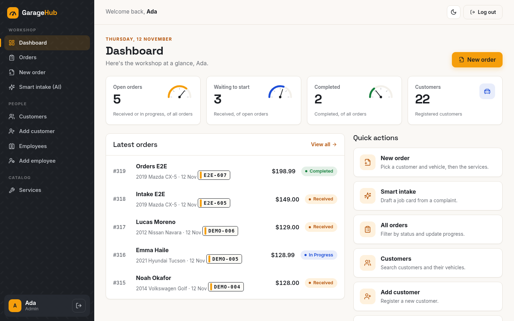
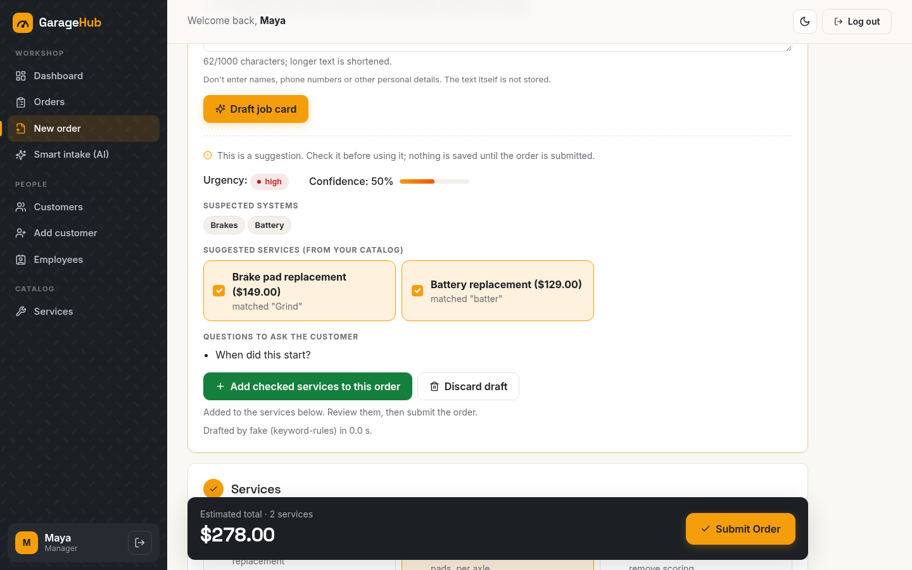
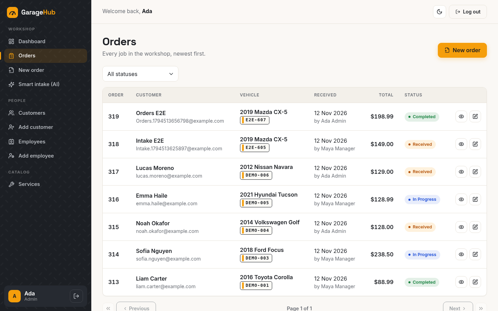
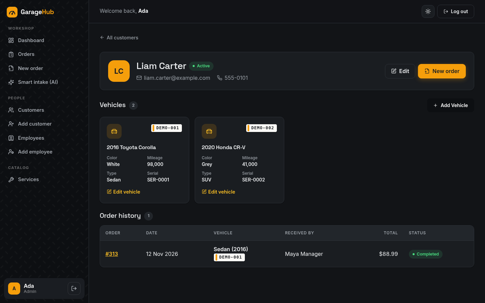
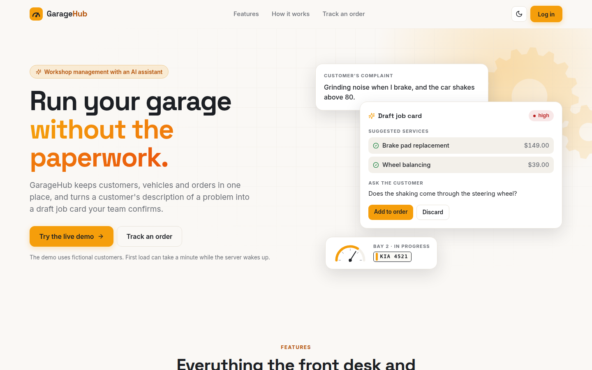

# GarageHub

[](https://github.com/kalkidanzabreham/abeGarageMainApp/actions/workflows/ci.yml?query=branch%3Amain)

Workshop management for a small car repair garage: customers, vehicles, orders and staff, plus an
**AI assistant that turns a customer's description of a problem into a draft job card** that a person
reviews before anything is saved.

**Live demo: https://abe-garage-main-app-theta.vercel.app** → *Log in* → **Try the demo, no password needed**
(read-only account; the data resets every night). The API runs on a free plan, so the first request
after a quiet period can take up to a minute while it wakes up.



## Highlights

- **REST API in Node.js/Express with MySQL**: role-based access from one permission matrix, input
  validation on every route, transactions for multi-table writes, versioned migrations, structured
  logs, a health check and OpenAPI docs.
- **AI feature built to be checked, not trusted**: structured output from Gemini or a local model,
  strict parsing with bounded repair and one retry, suggestions limited to the garage's own catalog,
  rate limits and a daily cap, and an evaluation on 40 held-out cases (results below).
- **Tested and automated**: 299 API tests (98.7% line coverage of the API layers) and 41 browser tests
  run on every push in GitHub Actions, against MySQL and a production build of the frontend.
- **Deployed for $0/month**: Vercel (frontend), Render (API in Docker), TiDB Cloud (MySQL-compatible
  database), with a daily demo-data reset from GitHub Actions. See [docs/DEPLOY.md](docs/DEPLOY.md).

## Screenshots

| | |
|---|---|
|  |  |
| New order: the AI draft suggests catalog services; a person ticks what to keep | Orders with status, vehicle plate and totals |
|  |  |
| Customer profile with vehicles and order history (dark mode) | Public landing page |

More in [docs/screenshots/ui](docs/screenshots/ui), including the customer's tracking page on a phone.

## What it does

| Role | Can |
|---|---|
| **Admin** | Everything, including staff accounts and the service catalog and its prices |
| **Manager** | Customers, vehicles and orders; use smart intake |
| **Mechanic** | See the work and update order progress, service by service |
| **Demo** | See everything a manager sees and try smart intake; the API refuses every change |

- **Orders**: received → in progress → completed, per-service progress, totals always computed by the
  API from catalog prices.
- **Customers and vehicles**: server-side search and pagination, a profile per customer with vehicles
  and order history.
- **Customer tracking link**: customers follow their order's progress with a private link; no account.
- **Smart job intake (AI)**: paste what the customer said; get likely systems, catalog services,
  urgency and questions to ask. Nothing is saved until a person adds it to an order and submits.
- **Light and dark mode**, usable on a phone at the counter.

## Smart job intake: how it works

```
complaint ──► input cap (1,000 chars, flagged if cut)
          ──► model call with a JSON schema (Gemini 3.1 Flash-Lite, or a local model via Ollama)
          ──► strict parse ──► bounded repair (fences, trailing commas, truncation, ...) 
          ──► one retry with the error, if still unusable ──► clean failure message otherwise
          ──► keep only services that exist in the catalog (unknown ones are dropped and reported)
          ──► draft shown to a person, who confirms or discards it
```

- Every repair and failure is logged with a reason code; the complaint text itself is never stored
  or logged.
- Per-user rate limit, an all-users per-minute limit and a daily cap, all from environment variables;
  `AI_ENABLED=false` removes the feature entirely. The API key stays on the server.
- Providers sit behind one interface, so switching between Gemini, Ollama and a no-model fake (used
  by the tests) is a configuration change.

**Evaluation**: 60 hand-labelled synthetic complaints (vague, multi-problem, misspelled, very short,
irrelevant, mixed Amharic/English), split 20 dev / 40 test before any tuning. The prompt was tuned on
the 20 dev cases only; the test set was run once per model. Results on the 40 test cases:

| | Gemini 3.1 Flash-Lite | gemma3:4b (local, laptop CPU) | Keyword rules (no AI) |
|---|---|---|---|
| Valid JSON on the first attempt | 39/40 | 40/40 | 40/40 |
| Final failures | 0/40 | 0/40 | 0/40 |
| Suggested services that were right | 48/48 | 37/40 | 29/31 |
| Expected services found | 33/37 | 22/37 | 19/37 |
| Urgency matches the label (always-"medium" baseline: 27/40) | 34/40 | 17/40 | 16/40 |
| Latency, mean / p95 | 2.5 s / 4.7 s | 35.9 s / 44.1 s | ~0 |

These are small, single-run numbers on synthetic data (one case is 2.5 points). Method, labelling
rules, every miss and the raw results are in [backend/eval](codeBase/abeGarage/backend/eval/README.md).

## Tech stack

| | |
|---|---|
| Frontend | React 18, Vite, React Router 7, Bootstrap 5.3 with a custom design system, light/dark mode |
| Backend | Node.js 20, Express 4, MySQL 8 (mysql2), Knex migrations, zod validation, JWT, bcrypt, helmet, pino, OpenAPI (swagger-ui) |
| AI | Google Gemini API (structured output), Ollama for local models, a fake provider for tests |
| Tests | Jest + Supertest (API), Playwright (browser), GitHub Actions |
| Ops | Docker (multi-stage, non-root), docker compose, Vercel, Render, TiDB Cloud |

## Security and quality

- One permission matrix (`backend/config/permissions.js`) used by every route; the frontend only
  hides what the API would refuse anyway.
- Passwords hashed with bcrypt; login answers the same way for unknown emails and wrong passwords
  (and takes the same time); failed logins rate-limited per IP.
- Every route validates its input with zod; all SQL is parameterized; errors have one shape:
  `{ status: "error", code, message }`.
- The one-click demo login only ever issues a short-lived token for the read-only Demo role, is
  rate-limited and can be switched off.
- Logs carry a request id, status and timing, never headers or bodies. `GET /api/health` checks the
  database. API docs: `/api/docs`.

## Run it locally

With Docker:

```bash
git clone https://github.com/kalkidanzabreham/abeGarageMainApp.git
cd abeGarageMainApp
docker compose up -d --build
docker compose exec api npm run db:setup   # tables + demo data
```

Open http://localhost:8080 and use **Try the demo**, or log in as `admin@garagehub.test` with
`local-admin-password` (local defaults in `docker-compose.yml`; change them for anything public).

Without Docker (Node 20 and a MySQL 8 server):

```bash
cd codeBase/abeGarage/backend
cp .env.example .env                       # set DB_* and JWT_SECRET
npm ci && npm run db:setup && npm run dev  # API on http://localhost:5000

cd ../frontend
cp .env.example .env                       # VITE_API_URL=http://localhost:5000/api
npm ci && npm run dev                      # http://localhost:5173
```

Smart intake: set `AI_ENABLED=true` and either `AI_PROVIDER=gemini` with `GEMINI_API_KEY`, or
`AI_PROVIDER=ollama` with a local model (`ollama pull gemma3:4b`; set `AI_TIMEOUT_MS=90000` on a CPU).
All settings are documented in [backend/.env.example](codeBase/abeGarage/backend/.env.example).

## Tests

```bash
cd codeBase/abeGarage/backend && npm test             # 299 tests; needs MySQL (see tests/testEnv.js)
cd codeBase/abeGarage/e2e && npx playwright test      # 41 tests; build the frontend first (see playwright.config.js)
```

CI runs lint, both suites and a coverage report on every push.

## Project structure

```
codeBase/abeGarage/
  backend/    Express API: routes, controllers, services, validators, middlewares,
              db/migrations, ai/ (intake pipeline, providers), eval/, tests/
  frontend/   React app: markup/layout (app shells), markup/pages, markup/components, styles/
  e2e/        Playwright browser tests
docs/         DEPLOY.md, screenshots/
```

## History

GarageHub started in February 2025 as a group project in a full-stack course ("Abe Garage"), built
with two teammates (johnyemande and Temesgen Yenialem in the commit history) from a provided HTML
template (`Resources/`). In late 2026 I reworked it into its current form: security fixes and a role
model, the automated tests and CI, Docker, logging and API docs, the smart intake feature and its
evaluation, the deployment, and a new interface.

## Known limitations

- Free hosting: the API sleeps after 15 idle minutes, so the first request can take about a minute.
- Rate limits are kept in memory, which is fine for one API instance; several instances would need a
  shared store such as Redis.
- The AI evaluation is small and synthetic; real complaints would need a fresh look at the labels.
